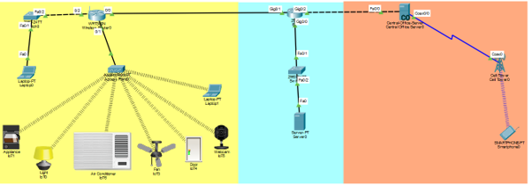

# Design and Configure a Small Network
## Smart Home Network Using Cisco Packet Tracer

A small network design and configuration project developed using Cisco Packet Tracer for the Wireless and Mobile Networking course (CIT 3703) at the Islamic University of Madinah.

The project simulates an integrated smart home communication system connecting Home, ISP, and Mobile networks to enable local and remote control of IoT devices.

## Table of Contents

- [Introduction](#introduction)
- [Project Objectives](#project-objectives)
- [Project Scenario](#project-scenario)
- [Topology Diagram](#topology-diagram)
- [Configuration Steps](#configuration-steps)
- [Remote IoT Control](#remote-iot-control)
- [Project Files](#project-files)
- [Tools and Technologies](#tools-and-technologies)

## Introduction

Modern smart home environments depend on communication between wired networks, wireless networks, mobile networks, and Internet of Things (IoT) devices.

This project uses Cisco Packet Tracer to simulate a complete end-to-end communication system. The network is divided into three interconnected parts:

1. **Home Network:** Contains smart IoT devices, laptops, and a wireless router. Smart devices connect through Wi-Fi and can be controlled locally using the Home Gateway.
2. **ISP Network:** Contains core network routers, a DNS server, and an IoT cloud-control server to support communication between the home and mobile networks.
3. **Mobile Network:** Uses a simulated 4G/LTE cell tower to connect a mobile phone and enable remote control of smart home devices.

## Project Objectives

1. Design and configure a small network integrating wired, wireless, mobile, and IoT components.
2. Connect smart home devices to a wireless network and enable local control through a Home Gateway.
3. Configure a mobile network using a cell tower to support remote access to smart home devices.
4. Configure IP addressing, routing, and gateway settings across the network segments.
5. Test communication and remote control of IoT devices.

## Project Scenario

### 1. Home Network

The home network includes smart devices such as lights, doors, thermostats, and furnaces, along with laptops and a wireless router.

IoT devices connect to the home wireless network and are managed through the Home Gateway.

### 2. ISP Network

The ISP network connects the different network segments and includes routers, a DNS server, and an IoT cloud-control server.

### 3. Mobile Network

The mobile network contains a simulated LTE cell tower and a mobile phone. It allows the mobile user to communicate with the home network through the ISP infrastructure.

## Topology Diagram

The following diagram illustrates the overall network topology, including the Home, ISP, and Mobile network segments.

## Configuration Steps

### 1. Wireless Router Configuration

The home wireless router is configured by setting the network SSID and wireless security parameters.

### 2. Connecting IoT Devices

The smart home IoT devices are connected to the home wireless network to enable communication with the Home Gateway.

### 3. ISP Configuration

The ISP network is configured to connect the Home, Servers, and Cell network segments.

Additional ISP configuration includes setting DHCP exclusions and creating the DHCP pool for the Cell network with the required network, default-router, and DNS-server settings.

### 4. Central Office Server Configuration

The central office server is configured to obtain its IP address automatically using DHCP.

### 5. Home Network DHCP Configuration

The ISP router is configured with DHCP exclusions and a DHCP pool for the Home network. The pool includes the network, default-router, and DNS-server settings. The home router is configured to obtain its WAN IP address automatically.

### 6. Enabling Remote Control on IoT Devices

Remote control is enabled on the smart home IoT devices to allow access from the mobile network.

## Remote IoT Control

After configuring the Home, ISP, and Mobile networks, the mobile phone is used to access and control the smart home IoT devices remotely.

The communication path is:

**Mobile Phone → LTE Cell Tower → ISP Network → Home Network → IoT Gateway → Smart Home Devices**

The following screenshots demonstrate the remote control process.

### Control the IoT Device – Screenshot 1

### Control the IoT Device – Screenshot 2

### Control the IoT Device – Screenshot 3

## Project Files

The Cisco Packet Tracer project file is included in this repository.

| File | Description |
|---|---|
| `Wireless Project.pkt` | Complete Cisco Packet Tracer network simulation |
| `Topology.png` | Overall network topology |
| `Wireless Router0 Configuration.png` | Wireless router settings |
| `ISP Configuration.png` | ISP network configuration |
| `ISP Configuration2.png` | Additional ISP and DHCP configuration |
| `IoT device.png` | IoT device connection |
| `Enable Remote Control in IoT devices.png` | Remote control configuration |
| `Central Office Server0.png` | Central office server configuration |
| `Control the IoT device.png` | Remote IoT control demonstration |
| `Control the IoT device2.png` | Remote IoT control demonstration |
| `Control the IoT device3.png` | Remote IoT control demonstration |

## Tools and Technologies

- **Cisco Packet Tracer:** Network design, configuration, and simulation.
- **Wireless Networking:** Wireless router and Wi-Fi connectivity.
- **Mobile Networking:** Simulated 4G/LTE connectivity.
- **Internet of Things (IoT):** Smart home devices and remote control.
- **DHCP:** Automatic IP address configuration.
- **DNS:** Domain name resolution.
- **IP Addressing and Routing:** Communication between network segments.

---

*Academic Lab Term Project – Smart Home Network Design and Configuration using Cisco Packet Tracer.*
